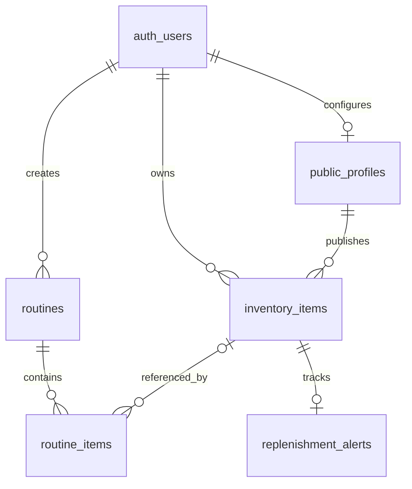

# Shelf and routine schema

This document describes the schema currently in `supabase/migrations/`. The
inventory table is named `inventory_items` because it predates the expansion
brief. It stores product snapshots owned by one Supabase user.

## Inventory items

`public.inventory_items` has a generated UUID primary key and a required
`user_id` foreign key to `auth.users` with cascade delete. Product data includes
`brand`, `product`, `shade`, free-text `category`, `hex`, an optional `url`,
`image_url`, and integer-cent `price_cents` plus `currency`. Shelf lifecycle
fields are `status`, `purchase_price_cents`, `purchase_date`, `opened_date`,
`notes`, `is_repurchase`, and the compatibility field `is_finished`.

Allowed status values are `using`, `backup`, `wishlist`, `finished`, `destash`,
and `panning`. `is_finished` is synchronized with `status` for compatibility
with the original routine-look UI. Prices are integer cents to avoid floating
point rounding in totals.

The table has row level security enabled. Its `own inventory` policy permits
select, insert, update, and delete only when `auth.uid() = user_id`.

## Routines and routine items

`public.routines` belongs to a user and currently represents a named look, with
`title`, `description`, `occasion`, `is_public`, and a random `share_slug`.
The `routine_type` extension preserves existing looks with type `look` and adds
`morning`, `evening`, and `weekly`. `public.routine_items` links ordered items
to a routine and supports a `step_name` and `notes`. Removing a shelf item sets
its routine reference to null, so the step remains visible.

`public.replenishment_alerts` links a shelf item to its owner and stores an
optional estimated lifespan plus low and empty flags. It is RLS protected and
only the owner may read or modify the alert for an item they own.

`public.public_profiles` stores one optional profile per user. Its `username`
is unique and URL safe, `bio` is limited to 160 characters, and `monk_tone` is
limited to 1 through 10. Profiles are private by default. Products have an
`is_public` flag, and routines already have an `is_public` flag.

Public profile reads use narrow security-barrier views rather than granting
anonymous reads to profile or inventory base rows. `public_profile_details`
contains presentation fields only. `public_profile_products` includes only
products whose owner has enabled a public profile and marked that product
public. `public_profile_routine_steps` includes steps from public routines and
reveals linked product details only when the product itself is public. Legacy
look links use `shared_routines` and `shared_routine_items` projections.

## Relationships

## Migrations

- `0001_inventory_and_routines.sql` creates inventory, looks, routine items,
  RLS, and the minimal public shared-items view.
- `0002_expand_inventory_lifecycle.sql` adds shelf statuses and lifecycle
  metadata while preserving existing rows.
- `0003_routines_and_replenishment.sql` adds skincare routine types, named
  steps, and replenishment alerts.
- `0004_public_profiles.sql` adds profiles, public product visibility, and
  narrow read-only views for public profiles and shared looks.

Run migrations through the project's Supabase migration workflow before using
the expanded shelf in a deployed environment.
